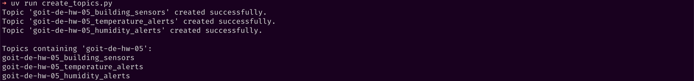
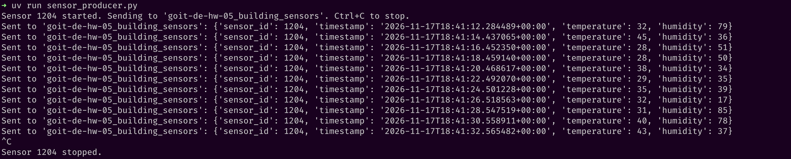
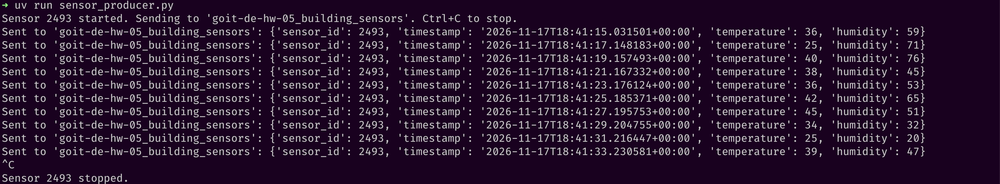
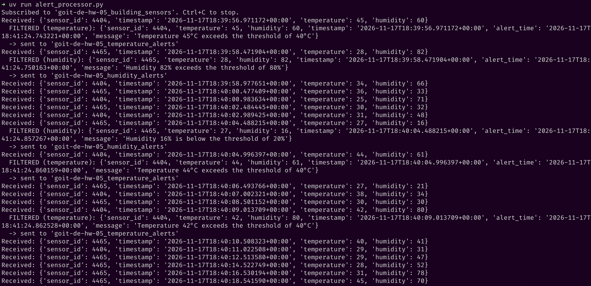
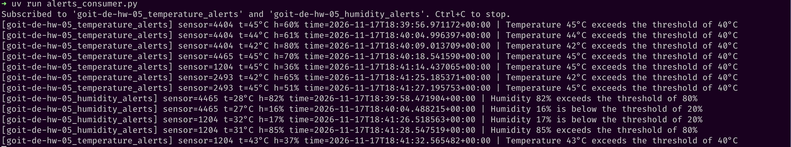

# goit-de-hw-05 — Apache Kafka

Система моніторингу IoT-датчиків: датчики пишуть температуру та вологість у Kafka,
процесор фільтрує показники, що вийшли за пороги, і розкладає сповіщення у два топіки,
а окремий споживач виводить сповіщення на екран.

## Файли

| Файл | Етап | Що робить |
|---|---|---|
| `configs.py` | — | Підключення до Kafka, імена топіків, порогові значення |
| `create_topics.py` | 1 | Створює 3 топіки та друкує їх список |
| `sensor_producer.py` | 2 | Імітує один датчик, пише у `building_sensors` |
| `alert_processor.py` | 3–4 | Читає `building_sensors`, фільтрує, пише у `temperature_alerts` / `humidity_alerts` |
| `alerts_consumer.py` | 5 | Читає обидва alert-топіки та виводить сповіщення |

Топіки мають префікс `TOPIC_NAME_SPACE` (за замовчуванням `goit-de-hw-05`):
`goit-de-hw-05_building_sensors`, `goit-de-hw-05_temperature_alerts`, `goit-de-hw-05_humidity_alerts`.

## Запуск

```bash
uv sync
```

Параметри підключення до Kafka задаються у словнику `kafka_config`
у `configs.py`. Префікс топіків — `TOPIC_NAME_SPACE` там же.

Порядок запуску — за кроками завдання (кожен скрипт — в окремому терміналі):

```bash
uv run create_topics.py      # крок 1, один раз
uv run sensor_producer.py    # крок 2, термінали 1 і 2 — два датчики одночасно
uv run alert_processor.py    # кроки 3–4, термінал 3
uv run alerts_consumer.py    # крок 5, термінал 4
```

## Результати

### 1. Створення трьох топіків



### 2. Генерація даних сенсорів та відправка у building_sensors (два датчики одночасно)




### 3–4. Отримання даних з building_sensors, фільтрація та відправка у temperature_alerts / humidity_alerts



### 5. Отримання сповіщень з обох топіків та виведення на екран


